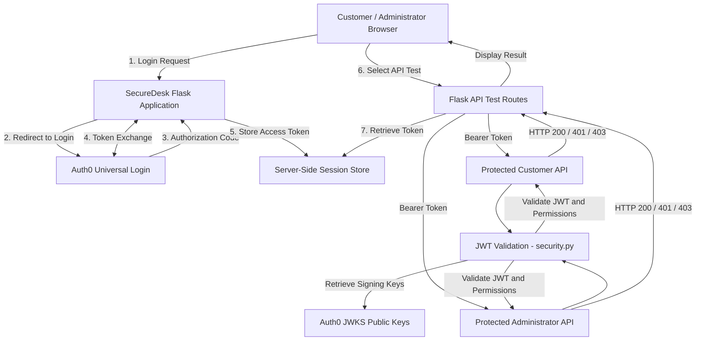
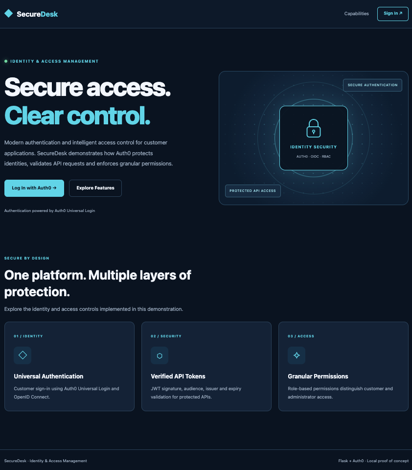
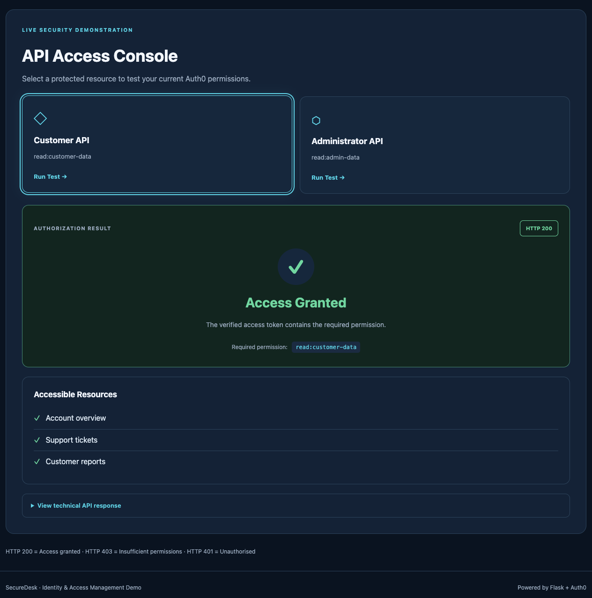
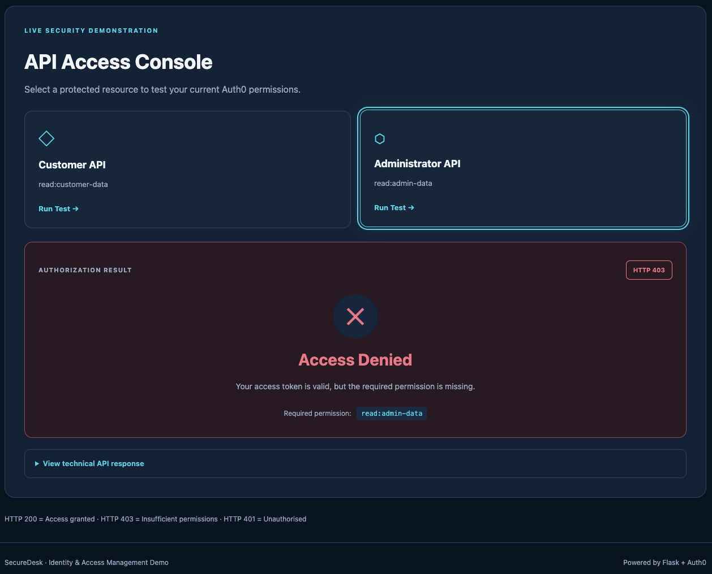
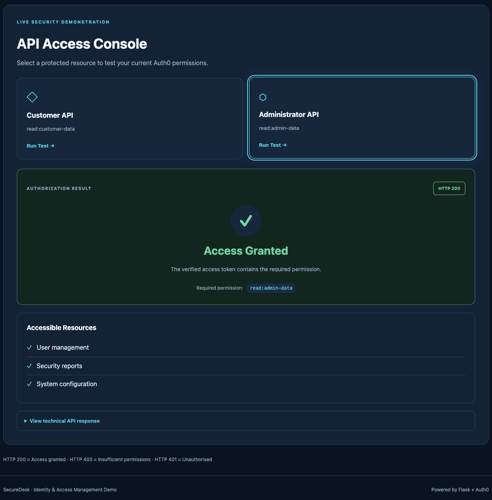
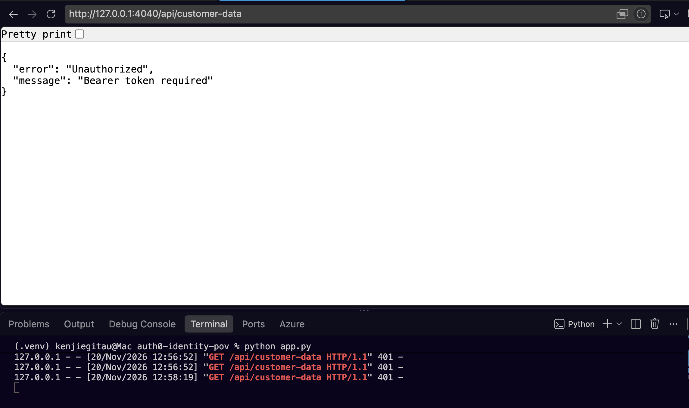

# SecureDesk — Auth0 Identity & Access Management Demo

A working identity and access management proof of concept built with
Python, Flask and Auth0.

SecureDesk demonstrates secure customer authentication, OAuth 2.0 /
OpenID Connect, JWT access-token validation and role-based API
authorisation through an interactive SaaS dashboard.

## Business Scenario

A growing SaaS organisation needs a secure customer portal.

Its requirements include:

- Secure customer authentication without developing a custom identity system.
- Protected REST APIs for customer resources.
- Separate permissions for standard users and administrators.
- Verification of identity and authorisation on the backend.
- Clear demonstration of successful and rejected API access.

## Proposed Solution

SecureDesk integrates Auth0 Universal Login with a Flask application.

Auth0 authenticates customers and issues access tokens for a
registered API. Flask validates those tokens and checks their
permissions before allowing access to protected resources.

## System Architecture

## Technology Stack

- Python and Flask
- Auth0 Universal Login
- OAuth 2.0 / OpenID Connect
- Authlib
- PyJWT and RS256
- Auth0 Role-Based Access Control (RBAC)
- HTML, CSS and JavaScript
- Flask-Session and CacheLib

## Access Control Model

| Account | Customer API | Administrator API |
|---|---|---|
| Standard User | HTTP 200 | HTTP 403 |
| Administrator | HTTP 200 | HTTP 200 |
| No Bearer Token | HTTP 401 | HTTP 401 |

Permissions:

- `read:customer-data`
- `read:admin-data`

The protected Flask endpoints validate access-token signatures,
issuer, audience, expiry and permissions.

## Security Test Results

Five local test scenarios were completed successfully.

### 1. Customer Portal

### 2. Standard User — Customer API

A Standard User with the `read:customer-data` permission
successfully accesses the customer API.

### 3. Standard User — Administrator API

A Standard User without `read:admin-data` receives
HTTP 403 Forbidden.

### 4. Administrator — Administrator API

An Administrator with the required permission receives
HTTP 200 OK.

### 5. Missing Authentication

A direct request without a Bearer token receives
HTTP 401 Unauthorised.

## Customer Value

The proof of concept demonstrates how a SaaS organisation can:

- Delegate customer authentication to a managed identity provider.
- Centralise role and permission management.
- Apply least-privilege access controls.
- Protect backend APIs independently of the user interface.
- Reduce the need to build and maintain custom authentication logic.

## Project Limitations

SecureDesk is a local proof of concept, not a production deployment.

Production readiness would require additional hardening, including
HTTPS, secure cookie configuration, durable server-side session
storage, appropriate CSRF protections, production WSGI hosting,
operational monitoring and further security testing.

The example customer and administrator resources are synthetic.

## Author

Kenjie Gitau

Developed as a practical identity-security and technical
Solutions Engineering demonstration.
